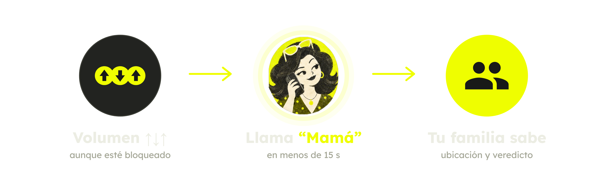
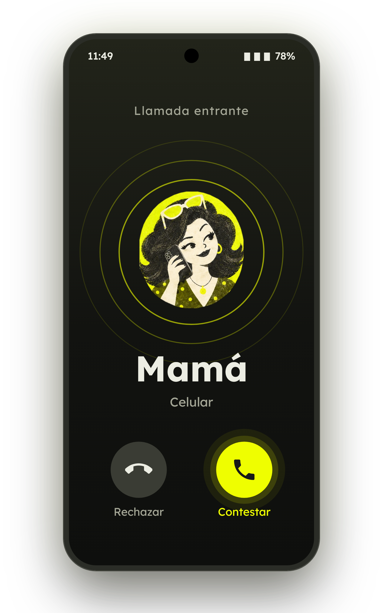
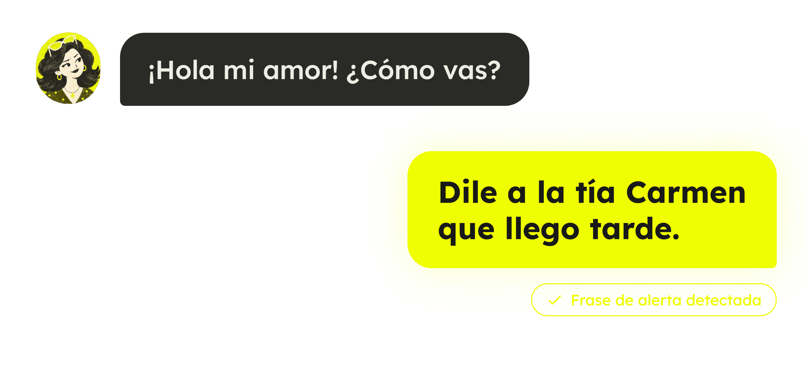
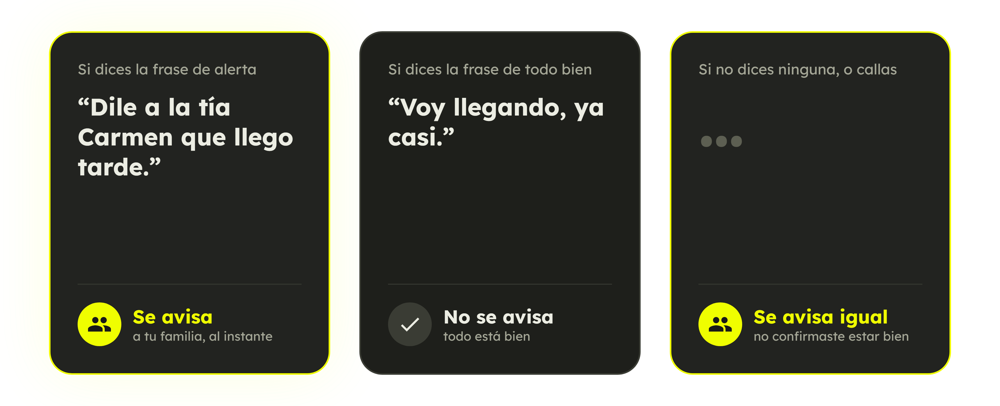

# MAMÁ


**Pide ayuda en secreto: una llamada de "Mamá" que, si estás en peligro, avisa a tu familia por WhatsApp.**

Platanus Hack 26: Caracas · Track 🚨 Emergencies · team-27

- 📱 **APK:** [app-release.apk](https://github.com/platanus-hack/platanus-hack-26-ve-team-27/releases/latest/download/app-release.apk)
- 🖥️ **Servidor:** https://mama-server.onrender.com (central privada en `/central/`, con clave)

## Qué es

## How it works

<p align="center">
  
</p>

<table>
  <tr>
    <td width="35%" align="center">
      
    </td>
    <td width="65%">
      <p>A real call from "Mamá" rings in. To anyone watching, it is just a call from home.</p>
      
      <p>You talk to her normally. Saying your alert phrase is the signal.</p>
    </td>
  </tr>
</table>

<p align="center">
  
</p>

Three outcomes: the alert phrase notifies your family at once, the all-clear phrase notifies no one, and anything else (or silence) notifies them anyway.

## Build and run
En un secuestro o un robo, sacar el teléfono para pedir ayuda puede empeorar las cosas. MAMÁ convierte una llamada normal con tu mamá en una alarma silenciosa:

1. **Configuración.** Tu nombre, los números de tu familia, una frase de alerta y una frase de "todo bien". La app guarda a "Mamá" en tus contactos.
2. **Disparo.** Volumen **arriba-abajo-arriba**, incluso con el teléfono bloqueado. La app manda tu GPS al servidor.
3. **Llamada.** En menos de 15 s te llama "Mamá": un agente de voz (ElevenLabs + Twilio) que te saluda por tu nombre.
4. **Detector de coacción.** Reglas + un LLM revisan la llamada. Frase de alerta o silencio: peligro. Frase de "todo bien": no se avisa. Ninguna de las dos: se avisa igual.
5. **Aviso.** La familia recibe un WhatsApp (Kapso) con tu ubicación, el veredicto, lo que se entendió de la llamada y el enlace a la ficha del caso, con la grabación.
6. **Central.** Una central web muestra cada alerta en vivo (estado y recorrido en el mapa) y su ficha completa al terminar.

El widget de la pantalla de inicio no llama: avisa a la familia de inmediato.

**Para la demo usa el patrón de volumen**, no el widget.

## Arquitectura

```mermaid
flowchart LR
  A[App Android<br/>volumen ↑↓↑ + GPS] -- POST /incidents --> S[Servidor Go<br/>Render + Postgres]
  S -- llamada saliente --> E[ElevenLabs Agent<br/>+ Twilio]
  E -- llamada de "Mamá" --> A
  E -- webhook post-llamada --> S
  S --> D{Detector<br/>reglas + LLM}
  D -- peligro / dudoso --> K[Kapso<br/>WhatsApp a la familia]
  S --> C[Central web<br/>y ficha del caso]
```

## Estructura del repo

```
app/        App Android (Kotlin, Jetpack Compose, Material 3)
mesh/       Malla BLE copiada de bitchat-android (GPL-3.0), módulo aparte
server/     Servidor Go (solo net/http) + Postgres
  cmd/server        main y rutas (newMux)
  internal/intake   recibe la alerta y decide el camino (llamada o aviso directo)
  internal/call     motor de llamadas con ElevenLabs/Twilio
  internal/duress   detector de coacción (reglas + LLM)
  internal/verdict  veredicto y contexto de la llamada
  internal/notify   WhatsApp a la familia (Kapso)
  internal/report   ficha del caso y central web
  evals/            70 diálogos etiquetados para medir el detector
docs/       contrato app-servidor, ADRs (docs/adr/), notas de diseño
scripts/    build, release, instalación y escaneo de secretos
```

## Stack

- **App:** Kotlin, Jetpack Compose, Material 3 (minSdk 26).
- **Servidor:** Go 1.24 (`net/http`), Postgres, desplegado en Render con [`render.yaml`](./render.yaml).
- **Voz y llamadas:** ElevenLabs Agents + Twilio.
- **Mensajería:** Kapso (WhatsApp Cloud API).
- **LLM:** Claude (Anthropic), solo si `ANTHROPIC_API_KEY` está definida. Sin ella, el detector usa solo reglas.

## Detector de coacción

`cd server && go run ./cmd/evals` corre los 70 diálogos y escribe [`server/evals/results.md`](./server/evals/results.md). Con solo reglas, en los 60 diálogos sin frase de "todo bien": precisión 1.000 y recall 1.000 alertando solo en "peligro". Si también se alerta en "dudoso", que es lo que ve la familia, la precisión baja a 0.806 y el recall sigue en 1.000.

## Correr en local

Requisitos: Go 1.24+, un JDK y el Android SDK (`local.properties` con `sdk.dir=...` o `ANDROID_HOME`).

```bash
scripts/build.sh                     # go vet + test + build del servidor, y assembleDebug + tests de la app
cd server && go run ./cmd/server     # escucha en $PORT (8080 por defecto)
adb install -r app/build/outputs/apk/debug/app-debug.apk
```

Las variables se cargan desde un `.env` en la raíz (`set -a; . ./.env; set +a`), que está en el `.gitignore`. Las principales:

| Variable | Para qué |
| --- | --- |
| `DATABASE_URL` | Postgres |
| `ELEVENLABS_API_KEY`, `ELEVENLABS_AGENT_ID`, `ELEVENLABS_PHONE_NUMBER_ID`, `ELEVENLABS_WEBHOOK_SECRET`, `ELEVENLABS_VOICE_ID` | Agente de voz "Mamá" y su webhook |
| `TWILIO_ACCOUNT_SID`, `TWILIO_AUTH_TOKEN`, `TWILIO_PHONE_NUMBER`, `TWILIO_WEBHOOK_BASE_URL` | Número de "Mamá" y llamadas |
| `KAPSO_API_KEY`, `KAPSO_PHONE_NUMBER_ID`, `KAPSO_WEBHOOK_SECRET` | WhatsApp a la familia |
| `ANTHROPIC_API_KEY` | LLM del detector y extracción del contexto de la llamada |
| `INCIDENT_REPORT_ENABLED`, `CENTRAL_KEY`, `DEMO_KEY` | Ficha del caso y central web |
| `CENTRAL_PUBLIC` | `true` abre la central a cualquiera, sin llave: ve cada incidente, su ubicación y su grabación. Solo para la demo. Apagada, manda `CENTRAL_KEY` |
| `FALLBACK_TOKEN` | Página de respaldo WebRTC |
| `CALL_LIMIT_*`, `NOTIFY_LIMIT_*` | Límites de llamadas y mensajes cada 10 min |
| `EMERGENCY_OFFLINE_ENABLED` y `EMERGENCY_*` | Canal offline por SMS y malla BLE (apagado por defecto) |

Ninguna clave va en el repo ni en la app. `scripts/build.sh` corre primero `scripts/secret-scan.sh` y se detiene si encuentra algo con forma de clave.

## Despliegue

- **Servidor:** Render despliega cada push a `main` desde un mirror del repo (Render no se conecta a repos de la organización). Para verificar: `curl https://mama-server.onrender.com/version` debe devolver el commit de `origin/main`, y `/health` debe responder `200`.
- **APK:** la URL del entregable siempre sirve el Release marcado como *latest*. Para publicarlo, desde `main` limpio y con el keystore del equipo en `~/.mama-keys/`:

  ```bash
  MAMA_SERVER_URL=https://mama-server.onrender.com \
  MAMA_TWILIO_NUMBER=+1XXXXXXXXXX \
  scripts/release-apk.sh            # --dry-run para probar sin publicar
  ```

  El script firma el APK y verifica el certificado, que no lleve secretos y que `HEAD` sea `origin/main`. Luego crea el Release `apk-<sha>` y descarga el enlace para comprobarlo.
- **Teléfonos de demo:** `scripts/install.sh` instala y abre la app en cada teléfono conectado por USB (`--reinstall` si antes tenía un build debug).

## Antes de la demo

- Twilio en modo trial no llama a +58: la cuenta tiene que estar activada y Venezuela habilitada en *Geo permissions*.
- WhatsApp solo entrega mensajes libres dentro de la ventana de 24 h: cada teléfono de la familia tiene que escribirle antes al número de Kapso.
- Más de 6 llamadas al mismo número en 10 min devuelven `rate_limited`. Sube `CALL_LIMIT_PER_NUMBER` en Render si hace falta.

## Decisiones

Las decisiones de arquitectura están en [`docs/adr/`](./docs/adr/): payload de emergencia offline, malla BLE de bitchat como módulo aparte, almacenamiento de emergencias offline, SMS en segundo plano solo por sideload y sello de la ficha del caso.

## Equipo

- Samuel Elías Palacios Alvarez ([@samuelpalacioss](https://github.com/samuelpalacioss))
- Sebastián Vera ([@sebaveaa](https://github.com/sebaveaa))
- Mariana Carolina Fes Rojas ([@marifesss](https://github.com/marifesss))
- Daniel Castellanos ([@dancas03](https://github.com/dancas03))
- Daniel Alejandro Ross Requena ([@danirssx](https://github.com/danirssx))

## Licencia

GPL-3.0 (ver [`LICENSE`](./LICENSE)). El módulo `mesh/` viene de [bitchat-android](https://github.com/permissionlesstech/bitchat-android). El origen está en [`mesh/NOTICE.md`](./mesh/NOTICE.md).
